<p align="center">
  
</p>

<h1 align="center">Riff</h1>

<p align="center">
    Riff is a Spotify client that puts your music library front and center. It features a clean, minimal design that lets you listen distraction-free, on Linux, macOS and Android.
</p>

<p align="center">
    <a href="https://flathub.org/apps/details/dev.diegovsky.Riff"></a>
</p>

---

> [!NOTE]
> Requires a Spotify Premium account. Some accounts may not work due to Spotify's new PlayPlay DRM, which is proprietary and cannot be implemented externally.

> [!IMPORTANT]
> This repository is a fork of [Diegovsky/riff](https://github.com/Diegovsky/riff) that adds native macOS and Android apps next to the GTK app. Upstream does not accept AI-generated contributions, following [Flathub's Generative AI Policy](https://docs.flathub.org/docs/for-app-authors/requirements/#generative-ai-policy) and [GNOME Circle's AI Policy](https://gitlab.gnome.org/Teams/Releng/AppOrganization/-/blob/main/AppCriteria.md#circle-app-criteria). The macOS and Android apps and the changes that support them were written with AI assistance, so they stay in this fork.

## Three apps, one core

Riff ships as three native apps that share the same Rust core:

- **Linux**: a GTK4 and libadwaita app, available on Flathub.
- **macOS**: a SwiftUI app for macOS 26 on Apple Silicon, with the sidebar, toolbar, menu bar and Settings window you expect on a Mac.
- **Android**: a Jetpack Compose app for phones on Android 13 and later, with a floating player dock, a media notification and background playback.

All three talk to Spotify through the same data layer, cache, login code, play queue, audio engine and librespot player. Only the interface and the desktop integration differ.

### Linux


### macOS

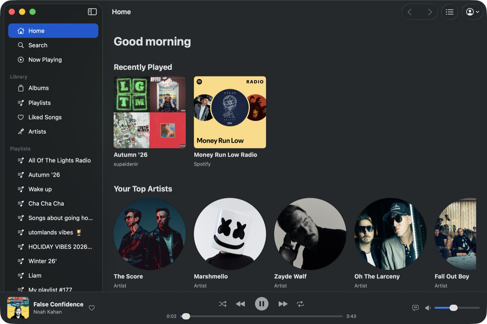

| | |
| --- | --- |
| 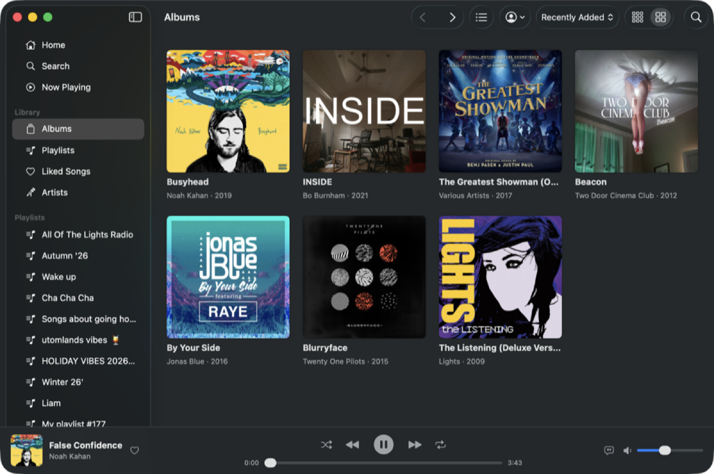 | 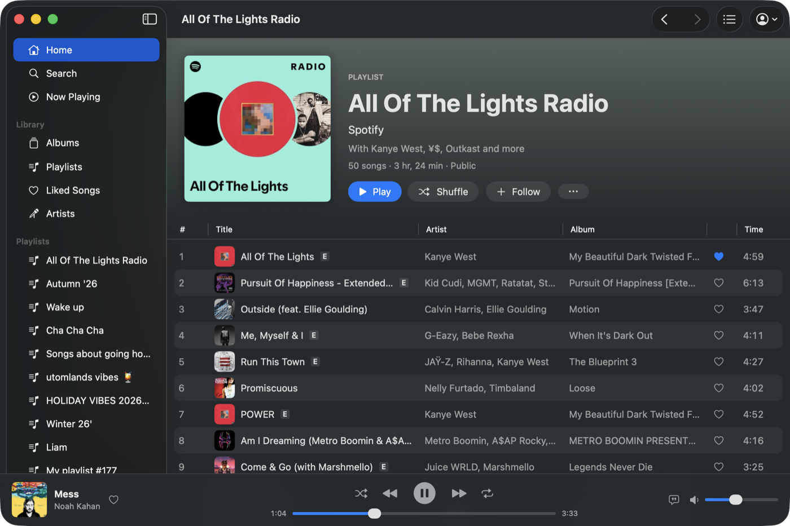 |
| 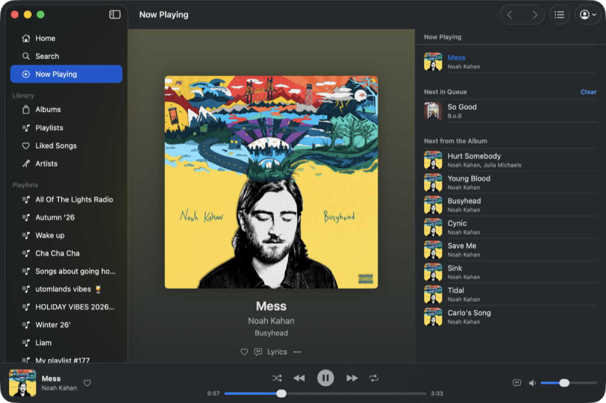 | 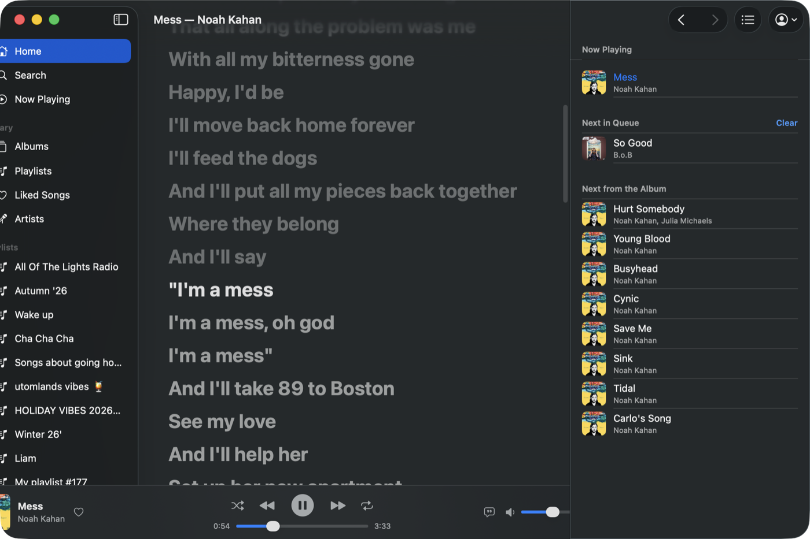 |

### Android

| | | |
| --- | --- | --- |
| 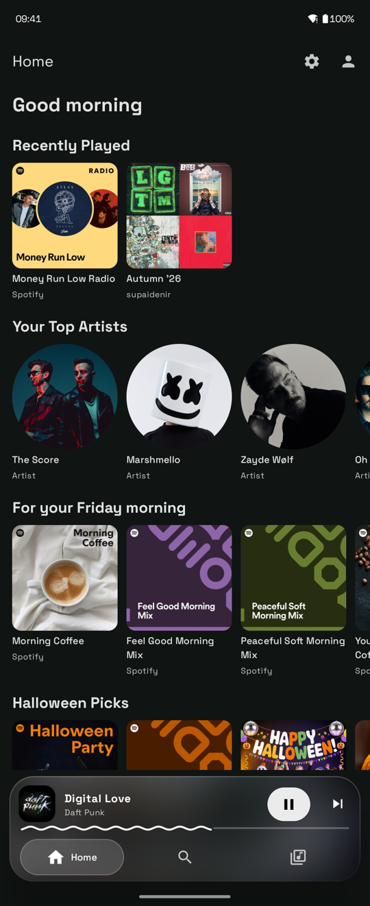 | 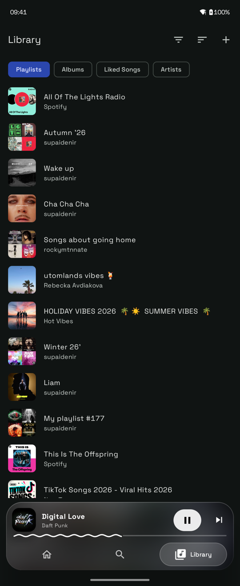 | 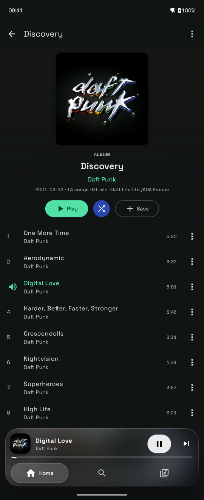 |
| 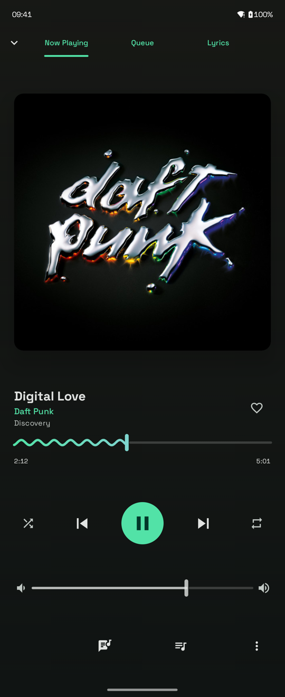 | 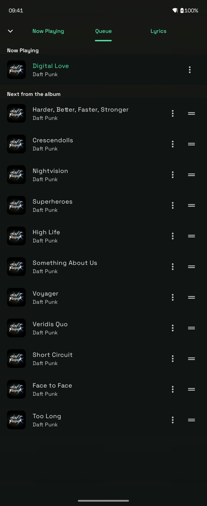 | 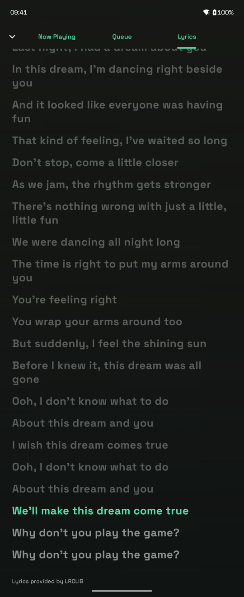 |

## Features

All apps:

- Play, pause, skip, seek, shuffle and repeat, with gapless playback
- A home page with recent listening, top artists, playlists for the moment and season, and the charts
- Your saved albums, playlists (with folders), liked songs and followed artists
- Search for songs, albums, artists and playlists, and open Spotify links
- Album, artist, playlist and profile pages, with playlist recommendations
- Create and edit playlists, including the cover image
- A queue you can reorder, plus "add to queue"
- Synced lyrics that follow the song
- A 10-band equalizer, stereo pan, pitch shift, mono audio and normalisation
- Spotify Connect: play on your other devices (behind a feature flag)
- Pin playlists, albums and artists to the sidebar, or the top of the library on Android (behind a feature flag)

On Linux:

- Light and dark themes with a responsive layout
- Media keys over MPRIS, session suspend inhibited while playing, credentials in the Secret Service keyring

On macOS:

- Media keys, Control Center and the lock screen through Now Playing
- The Mac stays awake while music plays, credentials are kept in the Keychain
- Menu bar commands with Mac keyboard shortcuts, a Settings window, and a queue inspector
- Offers to open Spotify links found on the clipboard
- Translations from the same gettext catalogs as the Linux app

On Android:

- A floating player dock that takes on the album art, with a wavy progress line like the system media controls
- Now Playing with Queue and synced Lyrics tabs, opened by tapping or swiping up the dock
- Background playback with the media notification, lock screen, Bluetooth and headset controls
- Pauses for calls and when headphones are unplugged, lets navigation prompts duck the music
- Opens `open.spotify.com` links and accepts links shared from other apps
- Long press to select several tracks, swipe queue entries away, drag to reorder
- Credentials encrypted with a key in the Android Keystore

## Installing

### Linux

**Flathub (recommended)**

```sh
flatpak install flathub dev.diegovsky.Riff
```

**Arch User Repository (AUR)**

```sh
yay -S riff-client
```

_Note: The AUR package is not maintained by us and may be out of date._

**From a GitHub release**

Pre-built bundles are available on the [Releases page](https://github.com/Diegovsky/riff/releases). Download the latest full release or development build Flatpak bundle and install it with:

```sh
flatpak install --user Riff-x86_64.flatpak
```

### macOS

Download `Riff-<version>.dmg` from this fork's releases (built by the `riff-macos` workflow), open it and drag Riff to Applications.

The app is not notarized yet, so the first launch needs right-click on Riff, then Open. macOS asks for your login password once so Riff can read its login from the Keychain; choose Always Allow.

### Android

Download `Riff-<version>.apk` from this fork's releases (built and signed by the `riff-android` workflow) on the phone and open it. Android asks once to allow installing apps from your browser or file manager. Requires Android 13 or later; the APK runs on arm64 phones and x86_64 emulators.

The first login opens Spotify's page in your browser and then returns to Riff. Every release is signed with the same key, so updates install over the previous version and keep you logged in.

Some phone makers stop background apps aggressively. If music stops with the screen off, set Riff's battery usage to "Unrestricted" in the app info.

## Building from source

### Linux

```sh
./scripts/setup-dev.sh                # install dependencies
./scripts/generate-spotify-api.sh     # generate Spotify API crate (requires Java)
./scripts/build.sh release --install  # build and install to ~/.local
~/.local/bin/riff                     # run Riff
```

See the [Development Guide](doc/Development.md) for full build instructions, project structure, and troubleshooting.

### macOS

Requires macOS 26, Xcode or the Command Line Tools (Swift 6.2), Rust and Java.

```sh
./scripts/build-macos.sh release --dmg   # builds build/macos/Riff.app and a DMG
open build/macos/Riff.app                # run Riff
./scripts/test-macos.sh                  # Rust and Swift tests
```

`./scripts/build-macos.sh debug --run` builds a debug app, with a Debug menu for feature flags, and runs it with logging in the terminal.

### Android

Requires rustup with the `aarch64-linux-android` and `x86_64-linux-android` targets, `cargo install cargo-ndk`, the Android SDK with platform 37 and an NDK, Java 17, and Java for the API generator.

```sh
./scripts/build-android.sh debug --install   # build and install a debug APK over adb
./scripts/test-android.sh                    # Rust and Kotlin tests
./scripts/test-android.sh --smoke            # plus the smoke test on the connected phone
./scripts/build-android.sh release           # signed release APK (needs RIFF_KEYSTORE and friends)
```

Debug builds install as `com.aidenir.riff.debug` and have a Debug section in Settings for feature flags.

## Project layout

| Path | What it is |
| --- | --- |
| `crates/riff-api` | Spotify data layer: provider-neutral models, HTTP, caching and request scheduling |
| `crates/riff-auth` | OAuth2 login and credential storage (Secret Service on Linux, Keychain on macOS, an app-provided store on Android) |
| `crates/riff-core` | Navigation history and the play queue, free of UI code |
| `crates/riff-player` | librespot session and playback, reporting back through a delegate |
| `crates/riff-audio-engine` | The audio processing chain: equalizer, pan, pitch, mono |
| `crates/riff-config` | Constants, GSettings access and feature flags |
| `crates/riff-ffi` | The macOS and Android core: Swift and Kotlin bindings (UniFFI), playback controller, Spotify Connect, settings |
| `crates/uniffi-bindgen` | Generates those bindings on the build host |
| `vendor/librespot-core` | librespot-core with one Android change (see `vendor/README.md`) |
| `src/` | The GTK app |
| `macos/` | The SwiftUI app |
| `android/` | The Jetpack Compose app |
| `po/` | Translations, used by both apps |
| `flatpak/` | Flatpak manifests |
| `doc/` | Developer documentation, including the [macOS plan](doc/macOS-Plan.md) and the [Android plan](doc/Android-Plan.md) |

## Contributing

Contributions to the GTK app are welcome upstream at [Diegovsky/riff](https://github.com/Diegovsky/riff); see the [Contributing Guide](CONTRIBUTING.md) and the [Development Guide](doc/Development.md). Translation contributions are temporarily paused while upstream migrates to a new platform.

## Code of Conduct

This project follows the [GNOME Code of Conduct](https://conduct.gnome.org). Please familiarize yourself with it before interacting with this repository.
